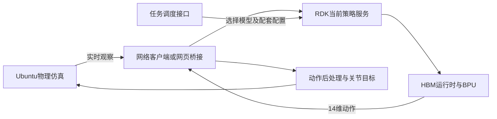

# MicroDuck任务七：端侧部署与多策略调度

> 本章学习的是**模型怎样部署、动作由谁计算、结果怎样验收**。无需训练新模型，也不要求拥有RDK X5。本次按“读保存输出＋看GIF＋核对代码与标记”的路线完成。

## 1. 先核对版本：开跑提示与当前保存输出不同

本次固定教程提交`a04dcfa31cf11a1a1115628ba107d9de0af38d52`，阅读`07_RDK网页与多策略_BPU验收.ipynb`。

| 材料 | 实际内容 | 应如何表述 |
| --- | --- | --- |
| 开跑提示描述的旧运行 | SSH报`No route to host`，播放`BPU-CACHED-VIDEO`，跳过板端审计 | 旧运行展示了离线学习与缓存回退，不能算当次板端推理成功 |
| 固定提交的Notebook保存输出 | walking上传并切换成功，出现`PASS-BPU-VIDEO`与`PASS-FRESH-BPU`；未出现缓存标记或上述SSH错误 | **保存的那次运行有在线BPU证据**；不代表今天开发板仍在线 |
| 固定提交的当前代码 | `MICRODUCK_RUN_BPU`默认关闭；`ALLOW_CACHED_BPU=False` | 关闭时跳过；启用后连接失败会报错，不能照旧提示假设自动回退 |
| 本次本机学习 | 执行关闭BPU的两个分支，均输出`NOT-RUN-BPU`；完成6项无板测试 | 完成部署链路学习与逻辑验证，**未完成新的HBM编译或真实板端运行** |

旧离线场景可以帮助理解降级设计，但不能替代对当前代码的检查；当前保存的成功报告也不能写成本次自己的成绩。

## 2. 问题①：没有RDK X5，怎样完成这一课？

按以下顺序阅读，不需要重装环境或重新训练：

1. 打开Notebook 07，先保留保存输出，依次读“模型检查→GPU视频→BPU视频→板端审计”。第一次可只阅读，**不要直接Run All覆盖原输出**。Jupyter播放器不显示时，可直接打开配套MP4/GIF。
2. 对照`recordings/gpu_videos/walking_gpu_latest.json`与`recordings/bpu_videos/walking_bpu_latest.json`，查看后端、模型哈希、运行编号、实际调用步数及重置记录。
3. 对照观看[历史缓存GIF](https://github.com/datawhalechina/every-embodied/blob/a04dcfa31cf11a1a1115628ba107d9de0af38d52/16-专题组队学习/05-MicroDuck运动策略与任务开发专题/01-任务资料/精选视频/assets/notebook-replays/walking_bpu_cached.gif)与[配套BPU演示GIF](https://github.com/datawhalechina/every-embodied/blob/a04dcfa31cf11a1a1115628ba107d9de0af38d52/16-专题组队学习/05-MicroDuck运动策略与任务开发专题/01-任务资料/精选视频/assets/notebook-replays/walking_bpu.gif)。两者画面都能动，**动作画面本身无法说明推理由谁完成**；必须查报告。
4. 读`rdk_bpu_policy_supervisor.py`的任务登记与切换接口，再读`notebook_runtime.py`的`verify_bpu_report()`，弄清“支持什么”与“验证了什么”。

若要执行无板分支，在Ubuntu/Jupyter中保持：

```python
import os
os.environ["MICRODUCK_RUN_BPU"] = "0"
os.environ["MICRODUCK_COMPILE_BPU"] = "0"
```

本机直接执行了Notebook的BPU视频、审计单元中关闭分支，均得到`NOT-RUN-BPU`，没有访问开发板。若还要新跑GPU视频，另行配置已有行走ONNX与运动环境路径；**关闭BPU只跳过板端步骤，不会自动补齐本地模型和依赖**。

本次还在既有Ubuntu Python环境中运行了课程原有的两个无板测试文件：

```bash
# 进入教程的03-Notebook目录，在已有运动Python环境中执行
python -m pytest test_bpu_inference_contract.py test_bpu_quantization.py -q
```

实测**6 passed，2.79秒**。测试使用模拟连接和模拟HBM运行时，覆盖循环状态重置、契约不匹配、非有限动作、旧运行/错误模型证据拒绝、INT16及循环状态重定标、动作缩放保持。它验证接口逻辑，不验证芯片性能或策略动作质量。

## 3. 问题②：ONNX、HBM分别给谁用？

| 对象 | 含义 | 本项目中的使用者 |
| --- | --- | --- |
| checkpoint，通常`.pt` | 训练权重及可能包含的优化器、归一化等状态 | 工作站继续训练、导出策略 |
| ONNX，`.onnx` | 通用神经网络计算图与参数；本身不是推理程序 | ONNX Runtime、网页运行时或兼容执行器；也作为X5工具链输入 |
| HBM，课程中的编译模型称呼 | 面向目标芯片/运行时编译后的部署产物，本专题常见文件后缀为`.bin` | RDK上的`hbm_runtime.HB_HBMRuntime`加载模型，执行BPU部署推理 |
| BPU | 芯片上的推理计算单元，是硬件，不是模型格式 | 计算当前策略动作，不在板上执行PPO/FastSAC训练 |

ONNX到HBM通常经过算子检查、图优化、校准量化与编译，才能得到目标运行时可加载的模型；**不是把文件后缀改成`.bin`**。转换需要匹配X5工具链和运行时，不能把任意地瓜芯片的编译模型混用。[官方X5转换说明](https://developer.d-robotics.cc/oe_x5_doc/cn/oe_mapper/source/faststart/quickstart.html)

本专题使用Ubuntu Docker工具链，核心命令形式为：

```bash
hb_mapper makertbin --config <本任务配置.yaml> --model-type onnx
```

这只是阅读用模板，本次没有执行。实际还需匹配版本的工具链镜像、静态输入形状、校准样本、输入布局及量化配置；板端负责运行，通常不需要在RDK安装编译器。

**校准数据要覆盖真实任务状态。** 只有零输入能出14个数，不代表走路、摔倒、恢复或技能交接时动作仍准确。还要核对归一化位于ONNX图内还是配套输入变换文件中，避免漏做或重复；有LSTM时，还需正确保存和重置隐藏状态，并处理其量化尺度。

### “板端在环”的分工



Ubuntu推进MuJoCo物理并渲染；RDK读取观察、执行策略并返回动作。网页经桥接器访问板端服务，桥接器转发数据；它不应悄悄用本地模型替板子算动作。**控制的是电脑中的仿真机器人，不能因此声称完成实体机器人部署。**

接口也不是所有任务都一样：行走常见61→14，Task05球平衡是54→14，篮球还有LSTM状态，爬梯另有动作滤波与增益要求。不能因为都输出14维，就直接互换模型。

## 4. 问题③：BPU-CACHED-VIDEO与PASS差在哪里？

| 输出标记 | 能说明什么 | 不能据此得出的结论 |
| --- | --- | --- |
| `PASS-local-onnx` | 本地模型结构、形状及一次输入输出检查通过 | BPU已经运行，或机器人已完成任务 |
| `PASS-GPU-VIDEO` | 工作站策略接入仿真，生成GPU推理视频 | 动作来自开发板 |
| `BPU-CACHED-VIDEO` | 展示此前保存的视频；旧提示场景中用于板子离线后的回退 | 本次板端在线、当前模型已实时驱动仿真 |
| `PASS-BPU-VIDEO` | 板端推理接入仿真并生成新视频的流程标记 | 任意同名旧文件都是本次结果，或任务质量已达标 |
| `PASS-FRESH-BPU` | 核对本次运行编号、模型SHA与完成步数后通过 | 保存报告在另一天打开，也等于当天重新测过 |
| `NOT-RUN-BPU` | 本次未执行板端推理 | 板子一定离线，或板端测试失败 |

因此，对旧提示的直接回答是：**缓存播放对应那次离线回退，而非在线实时验收**。更严格地说，缓存标记本身只证明“正在看历史材料”，并不是网络连通性检测结果。

`verify_bpu_report()`会检查视频存在且非空、`run_id`属于本次运行、`backend`匹配BPU、所选HBM/报告/板端返回的SHA一致、调用步数大于0且完成请求步数。不能只看到一行PASS，就忽略随后的校验失败。

当前保存的walking BPU报告记录了：

| 项目 | 配套历史记录，不是本机新测 |
| --- | --- |
| 后端 | `RDK X5 BPU via hbm_runtime` |
| 观察 / 动作 | 61 / 14，无LSTM |
| 实际 / 请求控制步数 | 500 / 500，即10秒仿真控制步 |
| 重置次数 | 0 |
| 网络往返平均 / P95 | 6.23 / 8.22毫秒 |
| 证据字段 | `fresh_inference_verified=true`，板端与报告模型哈希一致 |

50 Hz对应20毫秒控制周期，但网络往返不是完整控制耗时；还要算观察组装、物理、后处理及尾延迟，不能据均值直接保证实时控制。

**另一个易混点：** Task07长篇README还提供板端`CPUExecutionProvider`运行ONNX的网页路线，其独立多策略报告测试了walking、左右踢球各100次。那是另一条CPU ONNX链路，不能拿其约2毫秒往返结果给Notebook的BPU HBM路线背书。**在RDK上运行，不自动等于使用了BPU。**

## 5. 问题④：一块板子多套策略，这次真的切了吗？

### 架构支持的能力

`rdk_bpu_policy_supervisor.py`登记7个任务键：`walking、perturbation、stilt、swing、ladder、basketball、ball_balance`。其中扰动与行走共用walking模型，**7个任务键不等于7份不同模型，也不保证路径对应文件都已存在**。

| 调度操作 | 代码实际做什么 |
| --- | --- |
| `status` | 查询当前单策略服务状态、任务与模型哈希 |
| `switch` | 选择已登记任务；通常停止旧子进程，再启动新推理服务；同任务且服务存活时可直接返回状态 |
| `upload_and_switch` | 校验上传模型的SHA，处理配套输入变换，强制重新启动对应服务 |
| `switch_pair` | 启动/复用官方climber与get-up两套服务，分别监听不同端口 |

普通BPU路线中，8766是调度控制端口，8765是观察/动作推理端口；官方爬梯对使用8875、8876。README另一条CPU多策略服务也使用8766，**不能把两种协议的服务直接混接**。

所谓热切换是运行期间可重新选择策略，不代表零停顿、保留所有内部状态或多个模型每步都推理。切换时还要对齐观察维度、关节顺序、归一化、LSTM历史及动作滤波状态。

### 保存的这次运行证明了什么？

- 旧提示对应的离线运行：未取得新的板端切换证据，只能证明代码设计了调度接口。
- 当前Notebook 07保存输出：只记录**上传并切入walking服务，然后执行500步**；没有walking→篮球→高跷等连续换任务记录，不能写成“本次验证了多技能轮流热切换”。也不能断言原来一定在跑另一种任务。
- 本机本次无板学习：未发出真实切换请求。模拟测试通过，不等于完成板端切换验收。

要证明连续切换，至少需要按时间保存每次请求与响应、切换前后任务/模型SHA、对应推理调用和闭环结果。重复打印同一PASS或列出一排模型路径，都不能代替这些证据。

### 爬梯的两套实现必须分开

Notebook 06的社区路线是**climber＋get-up双模型**，通过`switch_pair`准备两套服务，再由Ubuntu监督器决定哪套接管。另有本地14级`ladder.bin`实验，代码保留`MICRODUCK_RUN_LOCAL_LADDER_BPU`显式启用标志并提示它不是社区复刻。

当前Notebook中官方`BPU_TASK == "ladder"`分支优先于后面的本地实验判断；**不能以为只设一个本地开关，就自动绕过官方分支**。先核对实际进入的分支、模型对与输入变换，再解释结果；单份`ladder.bin`不能冒充官方双模型。

## 6. 本次成果与复盘

完成了Notebook保存输出、两种GIF、BPU报告、调度源码和验收函数的交叉阅读；本机验证关闭BPU分支，并通过6项无板测试。没有重新训练、编译HBM、连接RDK或执行实体机器人控制。阅读摘要留在本机`outputs/task07_20261030/review_summary.json`，不上传含个人路径的原始Notebook输出。

**学习心得：** 从“模型能跑”转向判断“在哪跑、谁算动作、证据属于哪一次运行”。多策略调度既依赖模型接口一致，也依赖状态管理；能切换的设计与实际可靠完成切换，需要分别验证。

**课程反馈：** 无板阅读路线降低了入门门槛。建议同步旧离线说明与新版在线输出，明确缓存策略默认值，分开CPU ONNX与BPU HBM示例，并补充一份带模型哈希和时间线的连续换任务报告。

**资料入口：** [固定版本Notebook 07](https://github.com/datawhalechina/every-embodied/blob/a04dcfa31cf11a1a1115628ba107d9de0af38d52/16-专题组队学习/05-MicroDuck运动策略与任务开发专题/03-Notebook/07_RDK网页与多策略_BPU验收.ipynb)、[Notebook运行与部署说明](https://github.com/datawhalechina/every-embodied/blob/a04dcfa31cf11a1a1115628ba107d9de0af38d52/16-专题组队学习/05-MicroDuck运动策略与任务开发专题/03-Notebook/README.md)、[Task07完整教程](https://github.com/datawhalechina/every-embodied/tree/a04dcfa31cf11a1a1115628ba107d9de0af38d52/16-专题组队学习/05-MicroDuck运动策略与任务开发专题/01-任务资料/07-RDK端侧与网页部署)。
