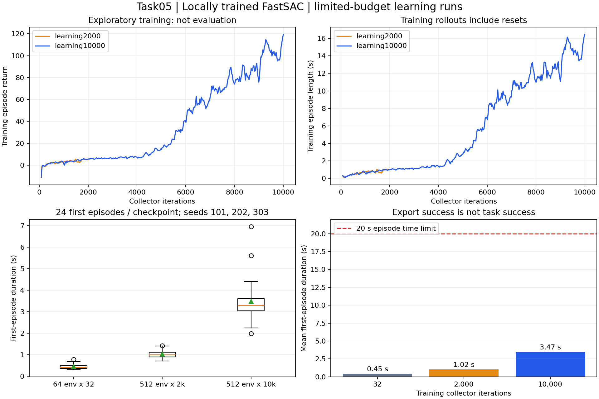
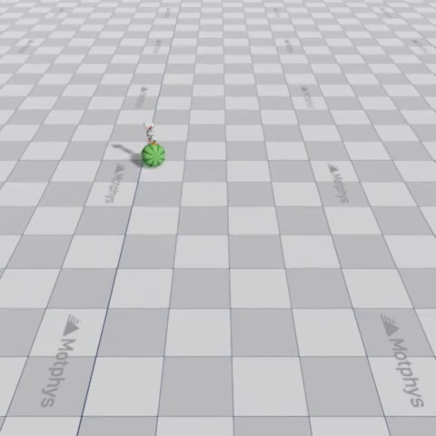

# MicroDuck任务五：球平衡、FastSAC与观测设计

> 本章重点不是证明FastSAC优于PPO，而是理解：**同样踩球，信息条件与实现路线变了，结果便不能只归因于算法。** 本文保留关键命令与本机证据，不把教程示例当作自己的成绩。

## 1. 问题①：除了算法，两条路线还差在哪里？

| 对比项 | Task01篮球平衡 | Task05 MotrixLab球平衡 |
| --- | --- | --- |
| 框架与仿真 | microduck-playground / mjlab、MuJoCo-Warp | MotrixLab / MotrixSim |
| 任务侧重点 | 保持球面平衡，并按速度指令滚动 | 保持直立、球留在双脚下方 |
| 算法 / 网络 | PPO / LSTM blind actor，带历史记忆 | FastSAC / MLP actor，无LSTM |
| actor可见信息 | 61维，不直接读取球位置、速度 | 54维，直接读取球相对位置及球速度的身体坐标表示 |
| 奖励与配置 | 速度跟踪、平衡、接触等组合 | 直立、高度、球在脚下、动作平滑等组合 |
| checkpoint来源 | 公开Hugging Face模型，可作为续训起点 | 使用官方任务与训练器训练；本机模型从随机初始化得到 |
| 部署接口 | 61维观察＋LSTM隐状态，输出动作及新隐状态 | 54维观察→14维动作，不需要LSTM隐状态 |

两者都输出14维动作，但关节顺序、缩放、归一化和物理响应必须分别核对，**不能直接交换checkpoint或ONNX**。

这不是控制变量实验：环境、任务目标、观察、网络、奖励、权重来源与训练预算都不同。即使某段视频更稳，也不能据此推出“FastSAC更适合球平衡”。

## 2. 问题②：54维比61维少，为什么反而能直接“看见球”？

**维数统计输入长度，不衡量信息价值。Task01的额外维度主要是命令与填充，不是球状态。**

| 输入组 | Task01 | Task05 |
| --- | ---: | ---: |
| 角速度3＋重力投影3＋关节位置14＋关节速度14＋上一动作14 | 48 | 48 |
| 前向、横向、偏航速度指令 | 3 | 0 |
| 头部 / 身体命令零填充 | 10 | 0 |
| 球相对位置 | 0 | 3 |
| 球线速度在身体坐标系中的表示 | 0 | 3 |
| **合计** | **61** | **54** |

- **Task01：间接推断。** actor不直接读球状态，通过身体反馈与LSTM历史记忆推断脚下球的运动；blind不是没有观察，也不是没有记忆。
- **Task05：直接提供。** 仿真把球相对身体的位置、球的运动信息直接交给actor，减少了从历史里推断隐藏状态的负担；这不代表一定更稳。
- **真机代价不同。** Task05部署时需由传感器或估计器提供同口径球状态，不能默认仿真中的精确信息天然可得；Task01不依赖直接球状态测量，但推断任务更难。

这里“看见”指**数值输入中包含球状态**，不代表actor读取摄像头图像。两个48维组也不能直接对拷：输入排列和归一化仍以各自契约为准。

Task05的critic（训练时估计价值的网络）是**63维**：在actor的54维之外，多读基座线速度、球世界位置和球世界速度，共9维。Task01的critic也能读特权球状态，**critic能读不等于部署actor能读**。

源码细节：Task05名为`ball_relative_velocity_obs`的项只是把球世界线速度转到身体坐标系，**没有减去基座线速度**；不要仅凭“相对速度”的名字改变输入含义。

## 3. FastSAC的“错题本”机制，以及不能预设的答案

| 算法 | 数据怎么用 | 类比的准确边界 |
| --- | --- | --- |
| PPO，on-policy | 主要使用当前策略新采集的数据，一批数据可做多轮更新，再换新数据 | “做完卷子就扔”不是每条数据只用一次，而是不长期保留旧策略数据反复训练 |
| SAC，off-policy | 把交互经验存进replay buffer，抽样复用；兼顾奖励与策略熵，保留探索 | “错题本”是经验池，不只保存失败样本，也包含成功经历 |

本实现由collector收集`观察→动作→奖励→下一观察`，learner从经验池抽样更新actor与Q网络，再把新策略发回collector；异步是两部分协作的工程方式，不是另一种任务。

**为什么这里用FastSAC？** 文档给出的是另一条实现路线，而非“球平衡已经证明应该用FastSAC”。经验复用、异步采样可能有工程价值，但属于待验证理由，不能直接当成选型结论。要比较算法，应尽量统一环境、观察、奖励、网络与交互预算，再做多训练seed评估；本章没有完成这种因果对照。

## 4. 问题③：smoke到底能确认什么？

smoke是**小预算流程检查**，不是策略效果验收。

| 已取得的证据 | 能确认 | 仍不能确认 |
| --- | --- | --- |
| 环境能初始化、step和reset | 场景与采样流程可运行 | 物理模型已真实准确 |
| 程序正常结束、写出checkpoint | 保存流程可用 | 参数确实更新、策略已经学会 |
| `update_idx`、优化器`step`大于0 | 优化器已执行更新 | 这些更新改善了控制效果 |
| 权重、观察、动作、奖励与已记录标量为有限值 | 本次检查未见NaN/Inf | 长训练必然稳定、所有状态都安全 |
| ONNX导出与parity通过 | 模型转换后的计算输出接近 | ONNX闭环成功率或真机效果达标 |

**关键坑：当前FastSAC配置`learning_starts=10`，先采样10轮才开始学习。仅跑教程的5轮，可能还未更新参数。** 本机改跑64环境×32轮，checkpoint实际只有**4次Q更新、1次actor更新**，不能用“轮数×每轮更新数”代替实测计数。

判断“学会平衡”还要独立评估：只统计每个环境第一次失败或到达20秒时限之前的表现。视频可在失败后自动reset，**录满10秒不等于连续站稳10秒**。

## 5. 本机结果：流程跑通，有改善，但尚未稳定平衡

固定源码：`24796cff1c00591bd327378df93461e1c4a9f89c`。环境为WSL2 Ubuntu 24.04、Python 3.10.22、MotrixLab 0.4.0、MotrixSim 0.10.1、PyTorch 2.7.0+cu128；RTX 5070 Ti的GPU矩阵计算通过。日志表明**物理环境步进在CPU，策略推理与学习在GPU**。

三组均从随机初始化独立训练，训练seed为1；评估用101、202、303三个seed，每个并行8环境，共24个首回合。它们是评估样本，**不是24个独立训练seed**。

| 指标 | 64环境×32轮 | 512环境×2000轮 | 512环境×10000轮 |
| --- | ---: | ---: | ---: |
| Q更新 / actor优化器step | 4 / 1 | 7,952 / 1,988 | 39,956 / 9,989 |
| 首回合平均持续时间 | 0.447秒 | 1.024秒 | **3.473秒** |
| 首回合最长持续时间 | 0.78秒 | 1.42秒 | **6.96秒** |
| 撑满20秒 | 0/24 | 0/24 | **0/24** |
| 真实观察ONNX最大动作误差 | 2.24×10⁻⁷ | 2.15×10⁻⁶ | 2.38×10⁻⁶ |

相关单元测试**12项通过**；三组权重与所检查数值均有限，ONNX均通过导出检查。真实观察对照来自PyTorch驱动的轨迹，**未单独重测ONNX闭环成功率**。

10000轮训练日志的最近窗口平均回合约16.46秒，独立评估却只有3.47秒。探索方式、随机状态、统计窗口不同，不能拿训练均值替代测试成绩；本次未单独归因差距。每种预算只训练一次，32轮组还改变了环境数量，这也不是严格消融实验。



上排是训练统计，下排是独立首回合分布；20秒虚线为评估时间上限。预算增加后本批样本表现改善，**不等于已经收敛，更不能用来证明优于Task01的PPO**。



最终短片为3秒、480×480、60 FPS，画面已核验。该帧仅证明可视化内容，不证明稳定成功。

## 6. 最小复现命令与实际踩坑

### 6.1 获取与安装

Windows侧在项目父目录下载源码与相关LFS资产：

```powershell
git clone https://github.com/Motphys/MotrixLab.git
cd MotrixLab
git checkout 24796cff1c00591bd327378df93461e1c4a9f89c
git lfs pull --include="motrix_robots/src/motrix_robots/assets/microduck/**,motrix_envs/src/motrix_envs/locomotion/ball_balance/**,motrix_envs/src/motrix_envs/common/motphys-ground.png"
```

用`wsl -d Ubuntu-24.04`打开Ubuntu，进入同一项目的挂载目录；确认能看见`pyproject.toml`与`uv.lock`，再执行：

```bash
export UV_PROJECT_ENVIRONMENT="$HOME/.local/share/microduck/venv-task05"
uv sync --frozen --no-default-groups --extra cuda --extra tbb --python 3.10
source "$UV_PROJECT_ENVIRONMENT/bin/activate"
```

`--frozen`沿用锁文件，`--extra cuda`选择CUDA依赖，`source`切换当前终端的Python环境。关闭终端后需重新激活；建好环境后直接运行`mxlab`，避免裸`uv sync/run`重新选择依赖。当前版本统一用`mxlab`，不是旧教程的`scripts/train.py`。

### 6.2 小规模训练与扩大预算

```bash
export OMP_NUM_THREADS=4 NUMBA_NUM_THREADS=4
mxlab train task=microduck-ball-balance/motrix.fastsac \
  num_envs=64 play_num_envs=4 seed=1 \
  algo.trainer.num_learning_iterations=32 \
  algo.agent.compile=false \
  algo.trainer.async_options.collector_compile=false \
  'algo.trainer.async_options.transition_ipc="off"' \
  'algo.trainer.async_options.weight_ipc="off"' \
  logging.interval=10 checkpoint.interval=500 play=false
```

`num_envs`是并行经验数，不是模型数量；iteration不是完整回合。两个`compile=false`只关编译、不关CUDA；`ipc="off"`只改进程间传输，不把学习改成CPU。参数采用Hydra的`键=值`语法，Linux续行符为`\`。

本机另外把环境数改为512、迭代数分别改为2000和10000，做了两组独立训练。未执行默认的2048环境×20000轮完整预算。

### 6.3 保存、回放与导出

run保存在`runs/microduck-ball-balance/motrix/torch/fastsac/<时间戳>/`。保留`metadata.json`、`task_config.yaml`和`checkpoints/latest.pt`，不要只移动pt文件。将下方`<run目录>`替换为实际路径：

```bash
mxlab play env=microduck-ball-balance \
  policy=<run目录>/checkpoints/latest.pt num_envs=1 seed=101 \
  record_video=true record_seconds=3 record_width=480 record_height=480 \
  +rl.agent.compile=false +rl.agent.amp=false

mxlab export-onnx run_dir=<run目录> output=<输出目录>/task05_policy.onnx
```

录像写入run下的`play_video.mp4`。导出器保留观察归一化与动作变换，接口为`[batch,54] → [batch,14]`；`batch`表示一次输入多少行观察。

### 6.4 实际踩坑速查

| 现象 | 原因 / 本次处理 |
| --- | --- |
| CUDA依赖下载慢 | 确认服务器直连可用后，仅对安装进程设置`NO_PROXY`例外；不改全局代理 |
| WSL报`invalid resource handle` | CUDA IPC失败，关闭transition与weight IPC后正常训练 |
| STL或纹理无法加载 | LFS指针不是真资产；除机器人与球，还要下载公共地面纹理 |
| 回放报`Key 'agent' is not in struct` | 追加覆盖项需写`+rl.agent...`；已存在的训练键不用`+` |
| 回放慢、首帧空 | WSL使用软件渲染；检查中段画面。最终3秒短片约耗时92秒 |
| pt已生成却可能没学习 | 检查预热轮数、`update_idx`和优化器step，不只看文件是否存在 |

原始训练、导出、评估记录保存在本机`outputs/task05_20261024/`，模型留在各自run目录。最终10000轮run为`26-10-24_22-52-23-992935`；公开笔记不上传环境、权重或原始日志。

**学习结论：** 先问“策略能看到什么”，再问“数据如何用于学习”，最后用独立评估判断“是否学会”。课程最有价值的是两条实现路线的对照；建议明确观测信息、smoke预热与成功判据，避免把换框架、出视频误写成算法优势。

**来源：** [Task01教程](https://github.com/datawhalechina/every-embodied/tree/a04dcfa31cf11a1a1115628ba107d9de0af38d52/16-专题组队学习/05-MicroDuck运动策略与任务开发专题/01-任务资料/01-MicroDuck篮球平衡强化学习)、[Task05教程](https://github.com/datawhalechina/every-embodied/tree/a04dcfa31cf11a1a1115628ba107d9de0af38d52/16-专题组队学习/05-MicroDuck运动策略与任务开发专题/01-任务资料/05-MotrixLab-MicroDuck球平衡与FastSAC)、[本次固定MotrixLab源码](https://github.com/Motphys/MotrixLab/tree/24796cff1c00591bd327378df93461e1c4a9f89c)。
