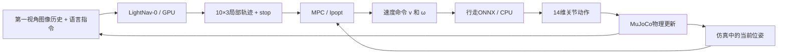
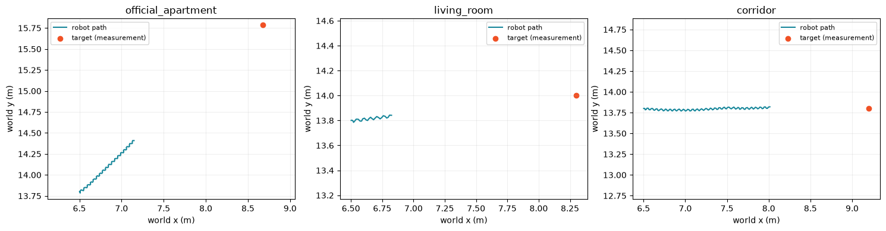
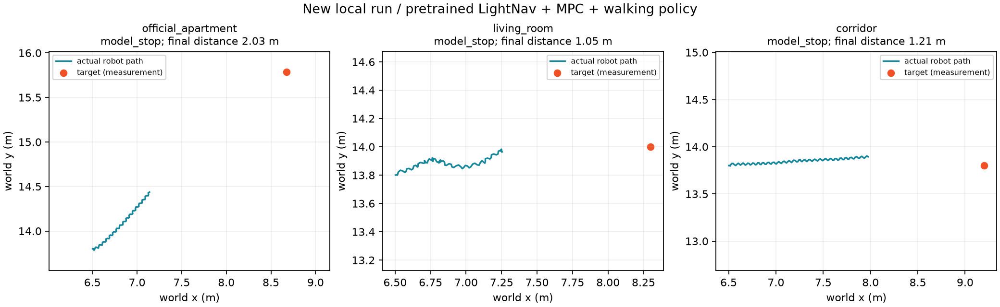

# MicroDuck任务八：LightNav视觉语言导航

> 本章把“看见什么、指令是什么意思、往哪里走”接到已有行走控制上。已完成三场景本机GPU实验；使用预训练模型，不训练，不连接RDK。**模型能输出轨迹、机器人能走动、机器人到达目标，是三个不同层次的验收。**

## 1. 问题①：比前七本多出来的理解能力从哪里来？

前七本主要处理运动技能及部署；本章新增**LightNav-0视觉语言导航模型**。它以Qwen3-VL-4B-Instruct为基础，接收第一视角RGB图像历史和文字指令，预测局部行走轨迹。图像提供环境和物体，语言指定目标，预训练与导航适配使两者关联；本课直接使用已有权重。[官方模型说明](https://huggingface.co/LightOriginsHQ/LightNav-0)

模型不是给“桌子”写一个固定坐标：APOS（可行行动点）和OPOS（目标物体点）两个空间指向通道，将行动意图对应到图像；三个RVQ动作码再解码成**10×3的局部平面位姿**。RVQ可理解为“用三层码本压缩表示一段轨迹”；不是另训一个关节控制器。

本课演示输入为**英文文字指令**；语音识别与中文指令效果未在本次验证。

| 层次 | 输入→输出 | 实际职责 |
| --- | --- | --- |
| LightNav-0，高层导航 | 第一视角图像历史＋指令→10个`[前向米数, 左向米数, 偏航弧度]`及停止标志 | 将视觉、语言对应到行动方向；本课使用GPU与vLLM |
| MPC，轨迹跟踪 | 预测轨迹＋当前平面位姿→前进速度`v`、转向角速度`ω` | 在速度、加速度约束内跟踪局部轨迹；由CasADi建模、Ipopt求解 |
| 已有行走策略 | 61维本体与命令观测→14维关节动作 | 接收速度命令、维持步态；本课ONNX Runtime使用CPU |
| MuJoCo，物理仿真 | 关节目标→接触、重力和下一时刻状态 | 机器人真实经过物理积分移动，再渲染新图像 |



**两个易混点：**10×3是未来的10个平面位姿，不是30个关节动作；MPC不是大模型，也不训练，它每次优化短时间的跟踪动作，只执行当前一步，再根据新状态重算。课程参数为导航4Hz、MPC 10Hz、行走策略50Hz、物理更新200Hz；MPC预测窗口5步，每步0.1秒。这些是仿真调度频率，不代表本机墙钟时间下也能达到相同吞吐。

预测轨迹先用**拍照时的机器人位姿**转换到世界坐标，再由MPC跟踪。仿真真值位姿参与坐标转换与反馈；**目标坐标只用于事后测距，不传给模型或控制器**。因此本课也不能直接宣称已实现真实机器人自主定位。轨迹点自身不附带执行时长，控制节奏由控制器定义。[上游模拟器接口](https://github.com/lightorigins/LightNav-0/blob/3015508b70fb6e30bbd66701e94c9b916dcb8df8/mujoco_demo/README.md)

## 2. 问题②：为什么“模型停止”不等于“目标到达”？

`lightnav_lesson.py`记录三种终止原因，当前教程保存的三段实验**全部是`model_stop`**，并不是三种原因各演示一次。

| 标记 | 代码中的含义 | 不能直接推出 |
| --- | --- | --- |
| `model_stop` | 收到模型的`stop=True`，停止导航、下发零速度 | 已到达目标、全程无异常 |
| `time_limit` | 仿真导航循环达到时长上限，默认24秒 | 目标不存在、模型完全不会导航 |
| `fall` | 主循环中躯干高度低于0.065米，或关节位置状态出现非有限值 | 所有可能的跌倒/不稳定情况都被完整检测 |

停止来自**模型动作输出的解码**，不是“真实位置距目标小于阈值”的判定。上游RVQ解码器会把显式停止码或接近零的轨迹解码为零轨迹，服务再生成停止标志；课程一旦收到它就退出导航。因此模型可能提前停止；也不能仅凭这一现象定位到视觉、语言、轨迹解码或控制中的某一个原因。

### 教程保存结果：三段都接近了目标，但尚不能称为到达

以下来自固定教程提交`a04dcfa31cf11a1a1115628ba107d9de0af38d52`的`lesson_summary.json`，**不是本机新跑成绩**。

| 场景与指令 | 预测次数 | 仿真时长 | 目标中心距离：起点→终点 | 缩短距离 | 终止原因 |
| --- | ---: | ---: | ---: | ---: | --- |
| 官方住宅：走向左侧桌子并停下 | 34 | 9.25秒 | 2.95→2.05米 | 0.90米 | `model_stop` |
| 新客厅：走向前方扶手椅并停下 | 12 | 3.75秒 | 1.81→1.47米 | 0.34米 | `model_stop` |
| 新走廊：沿走廊到盆栽并停下 | 49 | 13.00秒 | 2.70→1.17米 | 1.53米 | `model_stop` |



图由课程Notebook原始保存输出提取：蓝线是**机器人实际路径**，红点是**测量用目标位置**，不是LightNav预测轨迹。三条路径的末端与红点仍有明显距离；与表格中的末端距离一致。

三段末端距离都超过1米，不能把`model_stop`直接写成“导航成功”。不过1米也不是源码规定的正式成功半径；家具中心通常不可站入，严格验收应事先定义**可达目标区域、成功距离、是否允许碰撞/跌倒**。三段演示可说明链路有输出并产生移动，不能给出可靠的泛化成功率，也不能说明模型在所有新场景中失效。

另一个限制是**推理期间暂停仿真**。教程保存的推理延迟中位数约67.3、62.7、75.7毫秒；视频按仿真时间播放，`sim_seconds`还包含导航结束后的200个物理步，即1秒零速度收尾。视频流畅与报告时长都不能单独证明真实机器人能连续实时运行。

## 3. 怎样按顺序完成本课？

### 第一步：保留教程结果，先看清输出

1. 打开`03-Notebook/08_LightNav0_视觉语言导航_GPU_多场景.ipynb`，首次先阅读保存输出，避免直接运行全部覆盖证据。
2. 从单次预测读起：输入图像与英文指令，输出`stop`、原始动作码和`(10,3)`轨迹。教程第一条示例`stop=False`，前三个点约为`[0.146,0.039,0.262]`、`[0.291,0.078,0.262]`、`[0.437,0.117,0.262]`。
3. 看三个场景的视频，再对照路径图及`lesson_summary.json`；视频能动不代表已经到达。

注意：本Task08对应**Notebook 08视觉语言导航**；`01-任务资料/08-MicroDuck跨缝跳跃`是另一份材料，不要因编号相同而看错。

### 第二步：准备两个独立Ubuntu环境

沿用WSL2 Ubuntu与可用CUDA；导航模型环境使用**Python 3.11**，不能直接照搬此前Python 3.12运动环境。上游声明`>=3.11,<3.12`，固定`vllm==0.19.1`、`transformers==5.8.0`、`nvidia-cutlass-dsl==4.5.2`；不要跳过版本检查。

| 环境 | 内容 | 为什么分开 |
| --- | --- | --- |
| 导航模型环境 | PyTorch、vLLM、Transformers、LightNav权重与`action_tokenizer/` | 负责较大的视觉语言模型和GPU推理 |
| 仿真环境 | MuJoCo、CasADi、ONNX Runtime、渲染/视频工具 | 负责机器人、物理、MPC及低层行走 |

安装入口示例，路径均为可自定的通用示例：

```bash
# 在Ubuntu执行；先创建用于本课的目录
BASE="$HOME/microduck-task08"
mkdir -p "$BASE"
git clone https://github.com/lightorigins/LightNav-0.git "$BASE/LightNav-0"
git -C "$BASE/LightNav-0" checkout --detach 3015508b70fb6e30bbd66701e94c9b916dcb8df8

uv venv --python 3.11 "$BASE/env-model"
uv venv --python 3.11 "$BASE/env-sim"
uv pip install --python "$BASE/env-model/bin/python" -e "$BASE/LightNav-0[vllm,video]"
uv pip install --python "$BASE/env-sim/bin/python" \
  -e "$BASE/LightNav-0/mujoco_demo[microduck]" \
  jupyterlab ipykernel matplotlib imageio imageio-ffmpeg websocket-client
```

然后按[课程环境说明](https://github.com/datawhalechina/every-embodied/blob/a04dcfa31cf11a1a1115628ba107d9de0af38d52/16-专题组队学习/05-MicroDuck运动策略与任务开发专题/02-可运行代码/lightnav-learning/README.md)下载**官方LightNav整套权重**及`alpha_walking.onnx`，准备MicroDuck的`robot_allcollisions.xml`和同目录网格资源。不能只下载`safetensors`，漏掉处理器配置、`eval_config.json`与动作解码器。

### 第三步：改成本机路径，逐格运行

在Notebook环境配置处对应修改：

| 变量 | 应指向 |
| --- | --- |
| `LIGHTNAV_ROOT` | 上游LightNav-0代码目录 |
| `LIGHTNAV_MODEL_ENV` | 导航Python环境根目录，含`bin/lightnav-serve` |
| `LIGHTNAV_MODEL_PATH` | 完整导航权重目录 |
| `LIGHTNAV_ROBOT_MODEL` | 机器人XML文件，旁边保留网格资源 |
| `LIGHTNAV_WALKING_POLICY` | 官方`alpha_walking.onnx`文件 |
| `LIGHTNAV_OUTPUT` | 本次新实验输出目录，避免覆盖教程结果 |

教程默认的`/data/Data14TB/...`属于作者工作站，不能直接当作本机已有目录。先做资源检查，再启动模型服务，确认预热完成，最后运行“住宅→客厅→走廊”。无窗口渲染通常使用`MUJOCO_GL=egl`；先验证单张相机图像，避免等模型加载后才发现渲染失败。

本机还遇到了“模型已READY，但WebSocket握手断开”：轻量本地回声测试复现失败，清除代理后通过。**下载完成后，在本次本地实验进程中清除`http_proxy`、`https_proxy`、`all_proxy`及其大写版本，并设置`NO_PROXY/no_proxy=127.0.0.1,localhost`**；不要因此关闭全局网络设置。仅传入客户端的`http_no_proxy`参数，在本机不足以解决问题。

每个场景应保留四类产物：`*_latest.mp4`视频、`*_report.json`汇总、`*_predictions.json`模型预测、`*_trace.json`实际路径。预测点和实际路径不是同一份数据；分析偏差时应同时看。

## 4. 本次实际做了什么？

本次通过配套脚本调用课程原有`run_episode()`，完成三场景**新的本机GPU导航闭环**；原Notebook及保存输出保留。导航运行在GPU，行走ONNX运行在CPU，未训练、未连接开发板。

### 新实验结果

| 场景 | 真实预测次数 | 目标中心距离：起点→终点 | 仿真时长 | 推理延迟中位数 | 终止 |
| --- | ---: | ---: | ---: | ---: | --- |
| 官方住宅 | 32 | 2.95→2.03米 | 8.75秒 | 168.3毫秒 | `model_stop` |
| 新客厅 | 36 | 1.81→1.05米 | 9.75秒 | 176.4毫秒 | `model_stop` |
| 新走廊 | 47 | 2.70→1.21米 | 12.50秒 | 186.0毫秒 | `model_stop` |



这次同样出现“距离缩短、模型停止、目标仍有距离”的现象。客厅比教程保存结果更接近目标，仍不能据此宣布到达，也不能把差异归因于某一项改动：本次MuJoCo/ONNX Runtime版本与教程现场不同，并使用eager推理模式；每个场景也仅运行一次。

### 环境与模型记录

- 上游LightNav代码：`3015508b70fb6e30bbd66701e94c9b916dcb8df8`；导航权重版本：`826dc5fbfa37afa8293d2e336d329b6ffc0bfb64`。
- Python **3.11.17**；模型环境PyTorch **2.10.0+cu128**、vLLM **0.19.1**、Transformers **5.8.0**、CUTLASS DSL **4.5.2**；仿真环境MuJoCo **3.17.0**、ONNX Runtime **1.31.1**、CasADi **3.8.2**。
- 主权重约**9.7GB**，下载完成后整文件SHA256与官方校验值一致；同时补齐处理器配置及RVQ解码器。机器人模型复用既有MicroDuck资源，行走使用官方`alpha_walking.onnx`。
- 本机16GB显存环境使用`LIGHTNAV_GPU_MEMORY_UTILIZATION=0.80`、`VLN_VLLM_ENFORCE_EAGER=1`，单会话、2GiB KV缓存。它是本次可运行配置，不是所有16GB显卡的最低配置或性能保证。

### 验证范围

- 课程原有`test_lightnav_lesson.py`：**6 passed，0.28秒**，覆盖嵌套动作读取、响应序号不一致、轨迹形状错误/NaN/空数组及缺失布尔停止标志。
- 三个场景均实际编译、渲染，并执行100个零速度物理步；确认每个机器人**14个执行器、61维行走观测、有限物理状态和非空第一视角图像**。
- 三场景累计**115次模型预测**均为有限`10×3`轨迹，记录数与报告一致；实际路径和速度记录为有限值。三段视频均非空，可解码，分辨率**960×270**，播放时长约**8.9/9.9/12.6秒**。

前两项验证接口与仿真资源，最后一项核对真实导航输出；这些检查共同支持“闭环已跑通”，**不能替代到达目标或真实机器人实时运行的验收**。模型服务已在实验后关闭，权重和本地实验记录保留。

## 5. 坑点与结果应该怎样写？

| 容易踩的坑 | 正确处理 |
| --- | --- |
| 复用旧Python环境，升级后影响前几课 | 新建Python 3.11模型和仿真环境，前几课环境保留 |
| 大权重下载缓慢，官方并行后端超时 | 本次改用可用直连与分段下载，最后核对官方整文件SHA256；临时分块已清理 |
| 直接使用作者绝对路径 | 按六个环境变量逐项替换，目录、XML、ONNX文件要分清 |
| 把模型显存比例`0.22`当通用值 | 它是工作站示例；教程还显式指定2GiB KV缓存，比例不能单独限制总占用，需检查实际空闲显存 |
| 本地服务READY，连接却立即断开 | 下载与本地运行分开配置代理；在实验进程内清除代理并设置回环地址直连 |
| 页面可打开/机器人可手动走，就认为语言导航成功 | 检查真实模型预测次数、服务后端、轨迹和终止原因 |
| 看见`model_stop`就写“到达” | 把末端距离、目标区域、跌倒/碰撞条件一起验收 |
| 轨迹图蓝线被误当作模型预测路线 | `trace`是实际路径，`predictions`才保存预测轨迹 |
| 将新房间的三段演示当成泛化能力的充分证明 | 新布局复用原有网格；还需多指令、多起点、多次运行评估 |
| 直接把慢动作流畅视频称为实时控制 | 这里推理时暂停物理，须单独评估真实延迟和在线控制 |

本章的关键成果是读懂并验证**视觉语言模型→局部轨迹→MPC→运动策略→物理反馈**这条分层链路，并用距离和终止原因审视演示结果。没有训练新的导航模型，也没有完成真实机器人或RDK部署。

## 6. 来源

- [课程Notebook 08，固定教程提交](https://github.com/datawhalechina/every-embodied/blob/a04dcfa31cf11a1a1115628ba107d9de0af38d52/16-专题组队学习/05-MicroDuck运动策略与任务开发专题/03-Notebook/08_LightNav0_视觉语言导航_GPU_多场景.ipynb)
- [课程运行代码与测试](https://github.com/datawhalechina/every-embodied/tree/a04dcfa31cf11a1a1115628ba107d9de0af38d52/16-专题组队学习/05-MicroDuck运动策略与任务开发专题/02-可运行代码/lightnav-learning)
- [教程保存的三场景报告](https://github.com/datawhalechina/every-embodied/blob/a04dcfa31cf11a1a1115628ba107d9de0af38d52/16-专题组队学习/05-MicroDuck运动策略与任务开发专题/03-Notebook/recordings/lightnav_gpu/lesson_summary.json)
- [LightNav-0代码与模型机制](https://github.com/lightorigins/LightNav-0/tree/3015508b70fb6e30bbd66701e94c9b916dcb8df8)

第一张轨迹图来自Datawhale课程Notebook保存输出，第二张来自本机新实验；场景网格与机器人资产分别遵循各上游许可。
