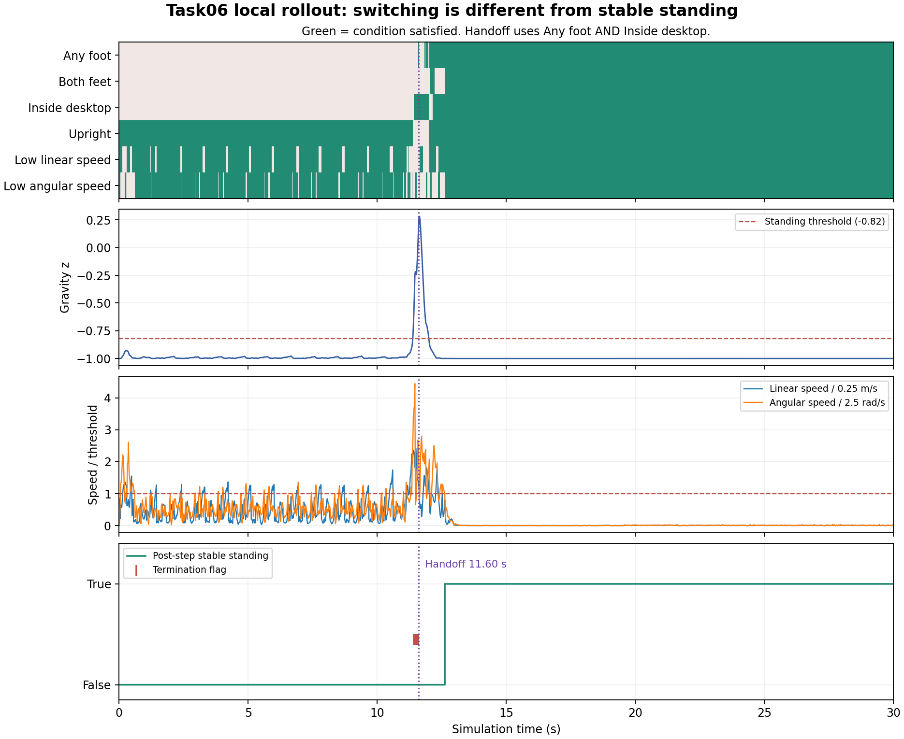
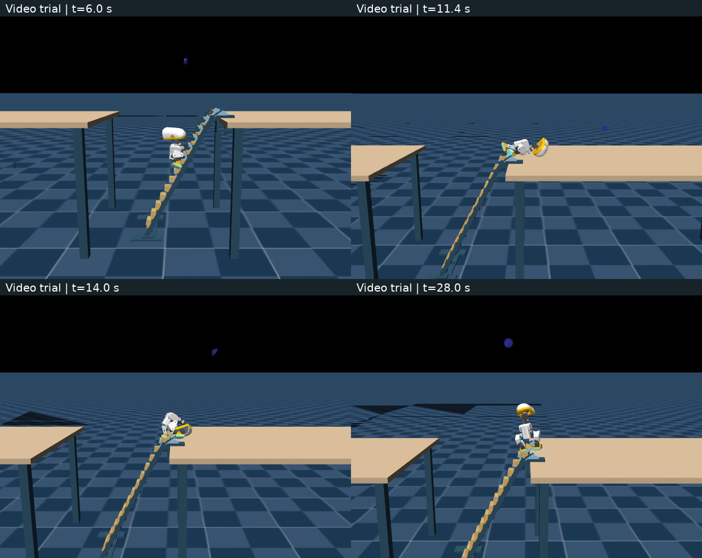

# MicroDuck任务六：梯面攀爬与双模型切换

> 核心收获：**触发切换、恢复站立、全程无失败是三件事。** 本机两次运行分别得到17.38秒与0秒稳定时间，不能凭一段成功记录认定交接已经可靠。

## 1. 先厘清：两个模型怎么接力？

`本体观测 → climber爬梯 → 监督器触发并锁存 → get-up起身 → 连续站稳验收`

- **actor**：决定14个关节的动作；本节两个actor均来自公开PPO检查点，不是Task05的FastSAC。
- **监督器**：读取仿真的脚部接触、桌面几何和根部位置，决定何时交接；不是第三个训练模型。
- **技能交接**：前一个策略产生的状态，必须落在后一个策略能处理的范围内；单独会爬、会起身，不保证接起来就成功。

两个模型均为**61维观察→14维动作**：角速度3＋重力投影3＋关节位置14＋关节速度14＋上一原始动作14，共48维；其余13个命令槽严格为零。actor不直接读取梯子与桌面几何，监督器却使用这些仿真真值。**blind actor不等于整个系统不需要环境信息。** 真机仍需实现并验证等价检测。

### 关键纠正：五重条件用于“站稳”，不是当前脚本的切换门槛

依据配套脚本`bpu_official_ladder_pair_video.py`：

| 判定 | 实际条件 |
| --- | --- |
| 允许切换`eligible` | **至少一只脚**真实接触桌面，且根部在规定桌内区域；默认满足1个控制步即可 |
| 桌面站稳`standing` | **双脚**接触桌面＋根部在桌内＋`gravity_z < -0.82`＋线速度范数`<0.25 m/s`＋角速度范数`<2.5 rad/s`，同时满足 |
| 序列成功`handoff_success` | 发生过切换，且切换后最长连续站稳不少于100步，即**2秒** |

`inside_desktop`不是“根部高度够了”：还检查相对桌沿进入至少4厘米、远端及侧边留有余量、根部高度大于0.66米。`gravity_z`是重力在身体坐标系的z分量，正常直立约为−1；越接近0，倾斜越明显。

切换采用`recovering = recovering or eligible`锁存：一旦进入get-up，即使后来失去接触，也不会自动退回climber。**误切可能无法回退，漏切则让climber继续处理本应交给get-up的状态。** 反过来，若强制机器人先站稳才能调用起身策略，也可能造成逻辑死锁。

### 接口相同，还必须对齐执行方式

| 项目 | climber | get-up |
| --- | --- | --- |
| ONNX输出 | 14个关节位置偏移，单位弧度 | 同左 |
| 执行动作 | 直接使用原始输出，不额外裁剪到`[-1,1]` | `执行值 = α×原始值＋(1−α)×上一执行值` |
| 滤波与增益 | 不滤波，基准BAM增益 | 头颈α=0.5、腿α=0.7，增益乘0.8 |
| 上一动作观察 | 上一时刻**原始输出** | 同左，不能替换成滤波后的执行值 |

目标关节角为`HOME＋执行偏移`，HOME和关节顺序以模型元数据为准。ONNX已包含观察归一化，不能再归一化一次；切换时沿用最后的执行动作初始化滤波，保持执行器延迟连续。每步只调用当前策略，并非两个模型同时输出再平均。

## 2. 问题①：GPU“成功”，termination_terms为什么还有失败？

**先核对数据版本。** 开跑提示引用“GPU稳定11.54秒、BPU为0”；本次固定教程提交`a04dcfa`的正文仍有旧摘要，但配套JSON已经是下面两份30秒记录：

| 配套报告，均非本机成绩 | 切换步 / 时间 | 最长连续站稳 | `handoff_success` | 出现`fallen`的控制步数 |
| --- | --- | ---: | --- | ---: |
| GPU `ladder_gpu_latest.json` | 629 / 12.58秒 | 15.74秒 | true | 48 |
| BPU `ladder_official_pair_bpu_latest.json` | 547 / 10.94秒 | 17.24秒 | true | 39 |

GPU报告第538步首次出现`fallen`；第540步还出现`bad_orientation`。第629步交接附近±3步未记录终止项，但第650步又出现`bad_orientation、fallen、off_side、foot_fling、overstep`。**不能把旧版第575步交接与新版第629步附近的记录拼成一条时间线。**

原因在评测实现：回放设置`auto_reset=False`，并清除待重置信号，失败标志不阻止后续恢复；`handoff_success`的公式也没有要求历史终止项为空。因此它表示“最终达到恢复站立指标”，不代表“按训练终止规则全程无失败”。

终止项包括姿态异常`bad_orientation`、摔倒条件`fallen`、侧向越界`off_side`等，具体含义取决于源码阈值。一个连续异常可能每步都被记录；**48个`fallen`标志步不等于摔了48次**。稳定判据与终止判据的区域、阶段口径也可能不同，不能只看字段名解释物理原因。

## 3. 问题②：BPU进入桌内，为何仍可能不切换？

**当前配套BPU报告实际切换成功，不能将“BPU完全失败”当成本版本事实。** 旧失败记录的逐步原始数据未在当前配套报告中找到；仅凭`stable_seconds=0`与没有切换，无法确认量化、模型、检测或接触中的哪一项导致失败。

诊断应按逻辑依赖推进：

1. **先查必要条件。** 若`inside_desktop=True`，但两脚接触均为False，则切换仍不满足；身体越过桌沿不代表脚形成支撑。当前GPU报告在550、575、600、625步的抽样正是这种情况，直到629步才触发。
2. **再分清另外三项影响什么。** 当前脚本不使用姿态、线速度、角速度阻止交接；它们可能阻止后续站稳，不能直接解释“为什么未切换”。若换了监督器实现，应重新阅读其条件。
3. **检查日志是否足够。** 课程`contact_trace`每25步记录一次，相隔0.5秒，可能漏掉短暂接触；`stable_trace`只在切换后写入，没切换时缺少姿态和速度日志，**没有数据不等于条件为False**。本机增加了每步、切换前后的五项记录。
4. **最后验证部署差异。** 固定同一观察与动作历史，对照CPU ONNX、GPU与板端HBM输出，核对模型哈希、输入归一化、原始动作反馈、滤波与增益。量化误差、校准覆盖不足是待验证假设，不能因为BPU失败就直接定性。

最小记录表应同时包含：时间、当前策略、左右脚接触、桌内判定、重力z、线/角速度、原始与执行动作、终止项。既要看单项是否满足，也要看它们**是否在同一时刻**满足。先记录和复现，再改阈值，避免把“降低验收要求”误当成修复。

## 4. 问题③：两个模型与一个模型硬学，各付出什么？

| 方案 | 主要收益 | 主要代价 |
| --- | --- | --- |
| 两个专家＋监督器 | 分阶段设计奖励与起始状态；可复用起身技能；问题容易定位到爬梯、交接或恢复 | 训练、导出、校准两套模型；维护动作与状态契约；监督器依赖检测，存在误切/漏切及交接状态分布不匹配 |
| 单策略学习完整流程 | 统一决策与动作接口，可能学到连续过渡，减少显式交接规则 | 长时序奖励分配和探索更难；爬梯与起身行为可能互相干扰；通常更依赖课程、恢复样本及训练预算 |

两者都要解决传感、接触和执行器一致性。**拆模型把一部分困难转移到交接处；合模型把困难更多放回训练中。** 本章没有统一预算的单模型对照，不能据此宣布哪种更优。

## 5. 本机实际完成了什么？

环境：WSL2 Ubuntu 24.04、Python 3.12.15、PyTorch 2.9.1+cu128、mjlab 1.3.0、MuJoCo 3.10.0、MuJoCo-Warp 3.8.1、Warp 1.12.0，RTX 5070 Ti。官方源码固定为`f010ef1cefcad49c05c20a4a78f840af83a643b9`，四个模型文件通过发布清单SHA256校验。

### 两次独立闭环：成功与失败都保留

均使用发布的ONNX双策略、seed=123、64环境中控制第17号环境，控制50 Hz，运行1500步，不自动重置。**本机策略与物理均在GPU；教程配套报告的物理在CPU，因此不是逐帧复现。** 64个环境也不等于本次测了64个独立受控样本。

| 本机运行 | 切换步 / 时间 | 最长连续站稳 | 序列成功 | 终止标志步数 |
| --- | --- | ---: | --- | ---: |
| A：不录像 | 580 / 11.60秒 | **17.38秒** | true | 9 |
| B：独立录像 | 570 / 11.40秒 | **0秒** | false | 790 |

A在571–579步触发`fallen`，其中573–579步也有`bad_orientation`；若另加“全程无终止标志”的严格要求，A也不通过。切换瞬间仅右脚接触桌面，`gravity_z=0.170`、线速度0.348 m/s、角速度5.811 rad/s，三项均不满足站稳阈值——**这是切换不要求先站稳的直接实测证据。**



绿色表示条件满足，紫色竖线表示交接；速度曲线除以对应阈值，低于1才合格。切换后仍需恢复一段时间，才能连续站稳。

两次初始61维观察完全一致、模型哈希相同，后续结果仍不同；GPU接触仿真存在轨迹分歧。这里只观察到重复运行结果不一致，**没有单独证明是录像导致差异，也不是有效的成功率统计**。

B的30秒、640×480、5 FPS视频已生成并检查。第28秒画面看似已经起身，但数据为：脚接触`[False, True]`、`inside_desktop=False`；姿态−0.973、线速度0.0031 m/s、角速度0.0267 rad/s均合格。**此时卡在支撑与位置，而非另外三个条件。**



这组图片属于失败的B运行，不能用A的17.38秒给它背书。完整视频保存在本机，笔记仓库仅收录图表与关键帧。

### 流程与学习更新验证

- 课程动作契约测试**9项通过**：覆盖切换锁存、原始动作历史、滤波及非法输入。
- A运行真实观察上的GPU/CPU ONNX最大动作差：climber约`1.31×10⁻⁶`、get-up约`1.43×10⁻⁶`；所检查观察、动作、奖励为有限值。输出接近不等于独立闭环轨迹完全相同。
- 两个公开PPO检查点各完成**64环境×5轮续训**，均保存`final.pt`；Adam各参数状态的step均增加100，actor权重实际变化且所查checkpoint张量有限；get-up观察归一化保持冻结。
- 两个短续训模型均通过官方导出器导出；各抽取64行真实观察核对PyTorch与ONNX，最大动作差分别为`2.15×10⁻⁶`与`1.43×10⁻⁶`。这验证转换计算，没有重新验收新模型的闭环成功率。
- 短续训只验证“采样→更新→保存”可用，没有证明新模型比发布模型更好；上述A/B闭环均使用**原发布ONNX**。
- 本次BPU部分完成配套报告与部署契约阅读，未连接RDK X5；也未进行实体机器人验证或V1/V2/V3整梯课程训练。

## 6. 最小复现步骤与踩坑

### 6.1 在Ubuntu准备独立环境

PowerShell执行`wsl -d Ubuntu-24.04`，然后在Ubuntu的项目父目录执行：

```bash
git clone https://github.com/Vottivott/microduck-playground.git microduck-climb
cd microduck-climb
git checkout f010ef1cefcad49c05c20a4a78f840af83a643b9
cd experiments/desk-climb/source

export UV_PROJECT_ENVIRONMENT="$HOME/.local/share/microduck/venv-climb"
uv sync --frozen --python 3.12
source "$UV_PROJECT_ENVIRONMENT/bin/activate"
python ../training/download_models.py
```

`--frozen`遵守锁文件；独立环境避免覆盖Task05的Python 3.10/FastSAC依赖。下载脚本校验`climber.pt/.onnx`与`getup.pt/.onnx`四个文件，不要只下载根目录的`policy.onnx`，它仅对应climber。

### 6.2 跑双策略，再检查报告

教程仓库与官方模型仓库是两个目录。在上述已激活环境中，用变量填入自己的实际位置：

```bash
PAIR_SCRIPT="<教程仓库>/16-专题组队学习/05-MicroDuck运动策略与任务开发专题/02-可运行代码/microduck-playground-stilts/scripts/bpu_official_ladder_pair_video.py"
DESK_ROOT="<官方仓库>/experiments/desk-climb"

python "$PAIR_SCRIPT" --backend gpu --official-root "$DESK_ROOT" \
  --climber-onnx "$DESK_ROOT/training/models/climber.onnx" \
  --getup-onnx "$DESK_ROOT/training/models/getup.onnx" \
  --num-envs 64 --record-env 17 --seed 123 --seconds 30 \
  --physics-device cuda:0 --output outputs/task06_pair.mp4
```

将`<...>`替换为实际目录后再执行。若希望对照教程的CPU物理设置，改为`--physics-device cpu`，但本机明显更慢。MP4、同名JSON及trace用于联合检查：**调用次数→切换事件→连续稳定时长→终止项→视频**；不能只看程序退出成功或视频长度。

### 6.3 两个策略分别做短续训

仍在官方`experiments/desk-climb/source`目录，先用小预算：

```bash
python ../training/run.py climber --envs 64 --iterations 5 --out outputs/task06_climber_smoke
python ../training/run.py getup --envs 64 --iterations 5 --out outputs/task06_getup_smoke
```

这会恢复已发布检查点的训练状态，不是从零训练。climber保留原0.74米恢复区域高度门槛，不能因物理桌面高0.66米就擅自替换；get-up使用98个训练起始状态并冻结actor归一化，154个验证状态另存。状态库未还原全部历史BAM/随机化缓存，所以仍需完整序列评估。

要继续使用新模型，按官方`TRAINING.md`的导出器保留归一化，再验证数值与整段接力；不要覆盖原发布模型，也不要把本节当成“把两个ONNX接上就必然成功”。

| 实际踩坑 / 易误用点 | 处理要点 |
| --- | --- |
| 教程摘要、开跑提示与JSON数值不同 | 固定提交，注明报告文件和运行范围，不混用旧指标 |
| Git部分克隆的对象下载挂起 | 本次改取同提交原始文件并逐个校验Git blob，随后修复检出；共核验266个所需文件 |
| CPU物理回放慢 | 停止本次低速尝试，改GPU物理；把后端差异写入实验口径 |
| ONNXRuntime提示`/sys/class/drm`检测失败 | 本机Torch CUDA仍可用，随后实际推理与数值检查通过；不要仅凭此警告判断CUDA失效 |
| Notebook通用导出单元出现FastSAC模板 | 梯面双策略以`desk-climb/TRAINING.md`的PPO导出流程为准 |
| 切换成功、视频看似起身，却稳定时间为0 | 回查双脚支撑、桌内位置及其余三项是否同时满足，不能只凭画面判断 |

原始记录、两次闭环报告、逐步判据、短续训模型与录像留在本机`outputs/task06_20261029/`。这里完成的是**公开双策略复现、更新链路验证与交接失败分析**，尚未证明跨随机种子的可靠攀爬。

**学习心得：** 复合技能的难点不仅在每个模型会什么，更在交接时能否把机器人交到下一个模型可处理的状态。比“跑出成功视频”更重要的是同时读懂触发、支撑、恢复与失败记录。

**课程反馈：** 双模型与GPU/BPU对照很有启发。建议统一旧摘要与最新JSON，明确区分切换门槛和站稳门槛，并在切换前也完整记录五项判据，方便初学者从证据定位失败。

**来源：** [Task06教程](https://github.com/datawhalechina/every-embodied/tree/a04dcfa31cf11a1a1115628ba107d9de0af38d52/16-专题组队学习/05-MicroDuck运动策略与任务开发专题/01-任务资料/06-MicroDuck梯面攀爬强化学习导读)、[官方模型卡](https://huggingface.co/HannesVonEssen/microduck-climb)、[固定版本动作与切换契约](https://github.com/Vottivott/microduck-playground/blob/f010ef1cefcad49c05c20a4a78f840af83a643b9/experiments/desk-climb/RUNTIME.md)、[固定版本训练说明](https://github.com/Vottivott/microduck-playground/blob/f010ef1cefcad49c05c20a4a78f840af83a643b9/experiments/desk-climb/TRAINING.md)。
