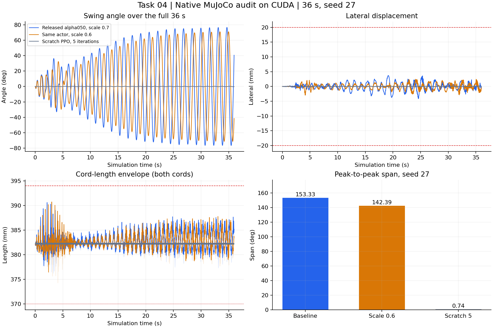

# MicroDuck任务四：摆动旋转仿真复现笔记

> 记录范围：固定源码下实际执行摆动策略评估、视频录制、ONNX 验证、动作缩放对照和小规模 PPO 训练。以下结果来自本机实验，不使用教程作者的成绩替代本机测量。

## 1. 本任务做什么

让 MicroDuck 从双绳秋千最低点静止出发，通过头部和腿部动作逐渐增加摆幅。重点是相位反馈、能量注入和平面约束，而不是让机器人靠横甩或异常绳长制造大角度。

此前 [[MicroDuck任务一-篮球平衡仿真复现笔记]] 关注自由球接触，[[MicroDuck任务二-浏览器物理扰动复现笔记]] 关注交互外力，[[MicroDuck任务三-高跷行走仿真复现笔记]] 关注形态变化；本任务进一步学习悬挂动力学与物理有效性筛选。

## 2. 环境与模型

| 项目 | 本次设置 |
| --- | --- |
| 运行环境 | 沿用 WSL2 Ubuntu 24.04、Python 3.12、NVIDIA CUDA |
| 实测依赖 | Python 3.12.15、PyTorch 2.9.1+cu128、mjlab 1.3.0、MuJoCo 3.10.0、Warp 1.12.0 |
| 项目 / Python 环境 | `microduck-stilts/` / `~/.local/share/microduck/venv-stilts` |
| 固定源码 | `c5fcc50219fef01ac9931d0079c583ccbb29b689` |
| 任务 | `Mjlab-SwingPump-MicroDuck` |
| 公开策略 | `experiments/swing/checkpoints/alpha050.pt` |
| 统一评估条件 | seed 27，36 秒，1800 个控制步 |
| 基线 / 参数对照 | 同一公开 actor，动作 scale 分别为 0.7 / 0.6 |

alpha050 checkpoint 的 SHA-256 与该固定版本的发布记录一致：`49fb3599be519cb604ed65e1ba495fb9f5746e5bee1d4cb95107dcd165f47f9c`。

## 3. 每一步做了什么

1. **沿用固定版本。**确认 Task 03 的源码版本和环境与 Task 04 匹配，不重新克隆或升级依赖。
2. **补取实验资源。**此前只稀疏检出了 `scripts/`、`src/`；补充 `experiments/swing/` 和 `tests/`，取得 alpha050 模型。
3. **运行配置测试。**`tests/test_swing_cfg.py` 共 **10 项通过**，覆盖双绳机构、静止初态、观测和约束逻辑。
4. **评估公开模型。**运行原生 CUDA 物理审计，保存完整 36 秒状态、绳长、侧移、挂点与执行器记录。
5. **录制并导出。**用 checkpoint actor 驱动 MuJoCo，生成 36 秒视频，再导出带归一化和动作裁剪的 ONNX。
6. **数值验证。**在 1800 个真实仿真观测上比较 PyTorch 与 ONNX 动作，确认部署图与 checkpoint 的计算约定一致。
7. **参数对照。**只把动作 scale 改为 0.6，其余模型、seed 和审计时长保持不变；另保留短视频。
8. **训练与候选验证。**从随机初始化策略执行 64 环境 × 5 轮 PPO，保存新 checkpoint；随后成功导出 ONNX、录制短视频，并完成 500 步一致性验证和完整 36 秒物理评估。

## 4. 关键命令

在 Ubuntu 的 `microduck-stilts/` 中执行，先选对环境：

```bash
export UV_PROJECT_ENVIRONMENT="$HOME/.local/share/microduck/venv-stilts"
export MUJOCO_GL=egl
export WANDB_MODE=disabled
git sparse-checkout add experiments/swing tests
uv run --with pytest pytest tests/test_swing_cfg.py -q
```

物理评估：

```bash
uv run python scripts/evaluate_swing_checkpoint.py \
  experiments/swing/checkpoints/alpha050.pt \
  --output artifacts/task04/baseline.json \
  --device cuda:0 --duration 36 --seed 27
```

从 checkpoint 录制视频并导出 ONNX，再做真实观测上的数值对照：

```bash
uv run python scripts/export.py Mjlab-SwingPump-MicroDuck \
  --checkpoint-file experiments/swing/checkpoints/alpha050.pt \
  --onnx-file artifacts/task04/baseline/policy.onnx \
  --device cuda:0 --num-envs 1 --seed 27 \
  --video True --video-length 1800 --episode-length-s 37 \
  --video-height 720 --video-width 1280

uv run python scripts/verify_swing_onnx_parity.py \
  experiments/swing/checkpoints/alpha050.pt \
  artifacts/task04/baseline/policy.onnx \
  --device cuda:0 --duration 36 --seed 27
```

以上是便于再次执行的命令；本次实际产物统一保存在第 7 节的独立实验目录。回放与导出本身不更新模型权重。

参数实验使用一次性的环境变量前缀 `MICRODUCK_SWING_ACTION_SCALE=0.6`，不会改变基线默认配置。

本次训练命令：

```bash
uv run train Mjlab-SwingPump-MicroDuck \
  --env.scene.num-envs 64 --agent.max-iterations 5 \
  --agent.save-interval 5 --agent.logger tensorboard \
  --agent.run-name task04-scratch-smoke-20261022-learning \
  --agent.resume False
```

这里明确是**随机初始化训练检查**，不是从 alpha050 续训。本任务每轮采样 48 步，因此 64 × 48 × 5 = **15,360 条 transition**。

## 5. 本机结果与解释

| 指标（seed 27，均审计 36 秒） | 公开模型 scale 0.7 | 同模型 scale 0.6 | 随机初始化短训 5 轮 |
| --- | ---: | ---: | ---: |
| 峰峰摆幅 | 153.33° | 142.39° | 0.74° |
| 最大绝对侧移 | 4.15 mm | 2.96 mm | 0.12 mm |
| 双绳长度范围 | 376.24～390.61 mm | 374.28～390.73 mm | 381.97～382.45 mm |
| 离线几何筛查 | 通过 | 通过 | 通过 |

三组均记录 1800 个有限值样本，未发现所检查的几何越界。**短训模型虽未越界，但几乎不摆动，尚未学会有效泵摆；几何合法不等于任务成功。**

基线的 ONNX 一致性验证：1800 步、seed 27，最大动作绝对误差 **1.2517×10⁻⁶**，动作裁剪范围为 [-1,1]。该检查让同一真实观测分别经过两种模型计算，不等于已经单独评测了一个 ONNX 闭环。

本次训练 seed 为 42，迭代编号为 0～4，最终文件为 `model_4.pt`。检查点有 17 组优化器状态，每组 Adam step 均为 60，与 5 轮 × 3 个学习 epoch × 4 个 minibatch 一致；不是只创建了一个空模型文件。训练日志记录的 NaN 终止为 0，各项 loss 的 5 个记录点均为有限值。

新 checkpoint 的 ONNX 验证覆盖 10 秒、500 步，最大动作绝对误差 **1.49012×10⁻⁷**。这证明新训练产物能保存、导出并保持计算一致，不代表已经训练出优于公开模型的策略。



图中三组审计均为 seed 27、36 秒；基线与 scale 0.6 使用同一个公开 actor，随机初始化短训模型只用于证明训练链路可用，不作为效果改进的证据。

本次控制缩放实验中，0.6 的摆幅与侧移都低于 0.7，说明调整控制幅度存在取舍。这是单 seed 观察，不推广为普遍规律。

上游公开的 seed 27 代表结果约为 173.20°，本机基线为 153.33°；本次运行使用 CUDA，未对与参考结果的差异做单独归因。没有重跑上游 100 seed 统计，不引用其 71/100 通过率作为自己的结果。

## 6. 原理与踩坑

| 问题 | 本次处理 / 学习点 |
| --- | --- |
| alpha050.pt 找不到 | 原因是稀疏检出缺少实验目录；通过代理补取资源，核对固定版本和 checkpoint 哈希 |
| 61 维接口看似与行走相同 | `[48:51]` 实际是摆动平面反馈 `[0, body_y_axis_world.x, body_y_axis_world.z]`，不是速度命令；使用任务原生观测，不照搬高跷的 `--running-speed` |
| 视频只录到默认回合结束 | 36 秒录像使用 1800 控制步，并将回合时限设为 37 秒；其他数值异常终止条件仍保留 |
| 累计转数与有效摆幅混淆 | 峰峰摆幅是最大角与最小角之差；累计角度很大，也不等于完成连续 360° 翻环 |
| JSON 生成不代表物理检查全通过 | 评估脚本会关闭提前终止以记录完整轨迹；须另核对侧移、绳长、挂点和有限值 |
| 录像和审计不是同一个进程 | 同模型、同 seed 的视频与 JSON 分别生成；没有逐步比对时，不给录像叠加声称精确对应的实时角度 |
| 仿真 36 秒不等于计算只需 36 秒 | 本机逐步诊断和离屏渲染明显更慢；50 FPS 是视频参数，不证明实机控制周期达标 |

actor 使用 IMU、关节反馈和上一动作，在摆动相位合适时调整身体；critic 在训练时可利用更多精确仿真状态。双绳只能受拉，奖励同时鼓励泵摆并抑制侧移、松绳、过伸和动作抖动。

离线几何筛查参考固定源码门限：侧移 20 mm、挂点对齐 penalty 0.05、绳长过伸 394 mm，以及双绳同时低于 370 mm 的深松弛；连续两步越界按源码规则记为持续违规。这是本机样本的离线筛查，不等于完整复现作者的模型选择和硬件验证。

## 7. 产物与完成边界

本次独立实验目录：

```text
microduck-stilts/artifacts/task04/run_20261022_learning/
├── baseline/    # 公开模型、36秒指标、ONNX、完整视频
├── scale060/    # 同actor的控制缩放对照、指标、短视频
├── scratch/     # 本次训练checkpoint、导出图、指标和短视频
├── logs/        # 配置测试、导出、parity与训练日志
├── summary.json
└── task04_comparison.png
```

最终核验：配置测试 10/10；三组 ONNX 均通过结构检查，接口均为 **61 维输入 → 14 维输出**，包含动作裁剪。公开模型完成 1800 步一致性验证，新模型完成 500 步验证。

视频均为 H.264、1280×720、50 FPS：基线 **36 秒 / 1800 帧**，参数对照和短训模型各 **10 秒 / 500 帧**；均已抽帧检查，画面正常。视频位于各组的 `videos/play/rl-video-step-0.mp4`。三个物理审计仍各为完整 36 秒，不因辅助录像缩短而缩短。

原始训练日志、TensorBoard 和 `model_4.pt` 位于 `microduck-stilts/logs/rsl_rl/microduck_swing/2026-10-22_21-32-54_task04-scratch-smoke-20261022-learning/`；checkpoint 另复制到本次 `scratch/` 目录，便于归档。

已完成的学习范围是公开策略复现、控制参数实验、小规模 PPO 训练检查及导出验证；**未运行教程中 4096 环境的长期训练，也未从零训练出高幅度策略**，没有进行开发板或真实秋千机构测试。后续若要研究训练效果，应逐步扩大训练预算，并用多 seed 完整评估衡量提升。

## 8. 学习心得与来源

这次体会到，机器人动作不能只看“角度大不大”。需要把控制效果、侧向稳定、机构约束和模型接口一起检查。实际执行 PPO 后，也更清楚地区分了“模型能导出”“训练确实更新了参数”和“策略已经学会任务”这三个层次。

- [Task 04 教程](https://github.com/datawhalechina/every-embodied/blob/a04dcfa31cf11a1a1115628ba107d9de0af38d52/16-专题组队学习/05-MicroDuck运动策略与任务开发专题/01-任务资料/04-MicroDuck摆动旋转强化学习复现/README.md)。
- [固定版本摆动实验](https://github.com/Vottivott/microduck-playground/tree/c5fcc50219fef01ac9931d0079c583ccbb29b689/experiments/swing)。
- [公开模型与观测契约](https://huggingface.co/HannesVonEssen/microduck-swing)。
